# 餐这儿

> 一款纯前端 H5 餐饮经营小游戏。浏览器打开即玩，零后端依赖。

选址开店、雇佣员工、接单出餐，从小摊做到连锁大亨 —— 全程在浏览器里完成。

## 截图

| 开始 | 选址开店 | 选择店型 |
| :---: | :---: | :---: |
| 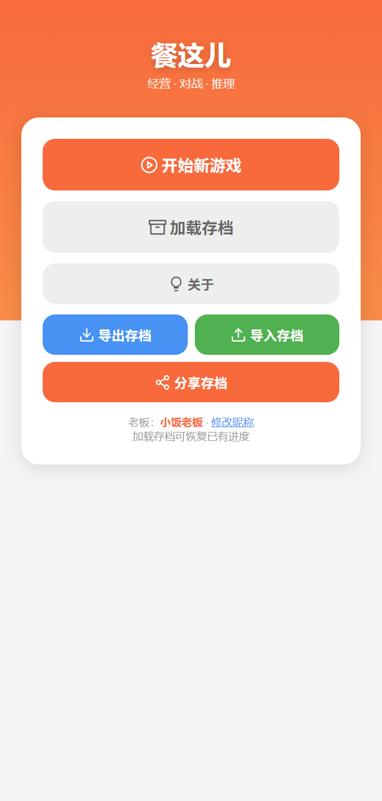 | 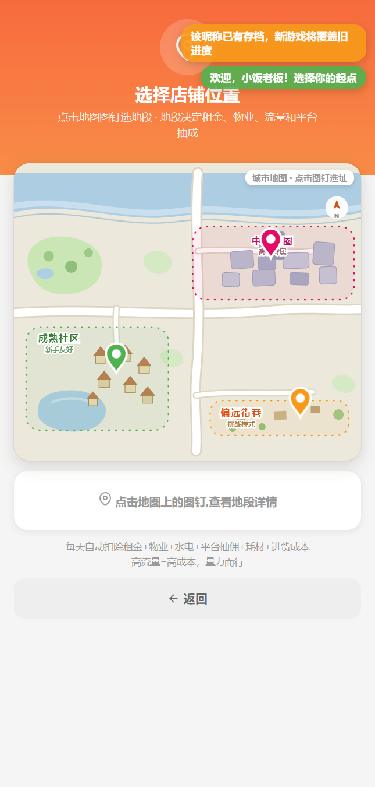 |  |

| 店铺经营 | 员工 | 加盟招商 |
| :---: | :---: | :---: |
| 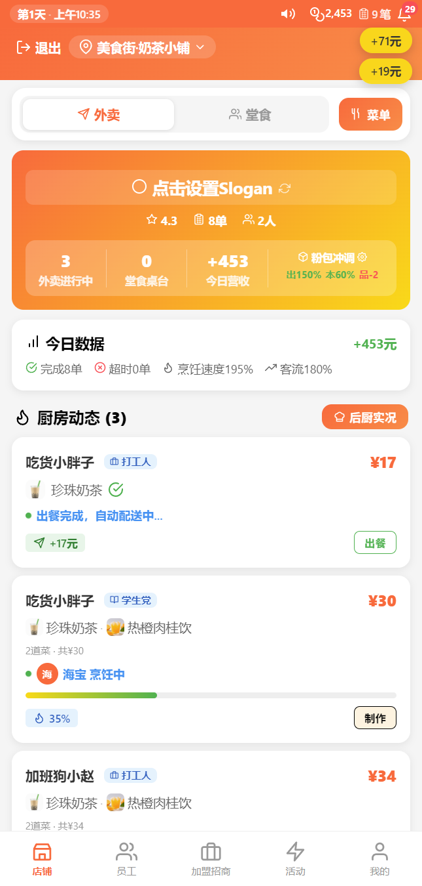 | 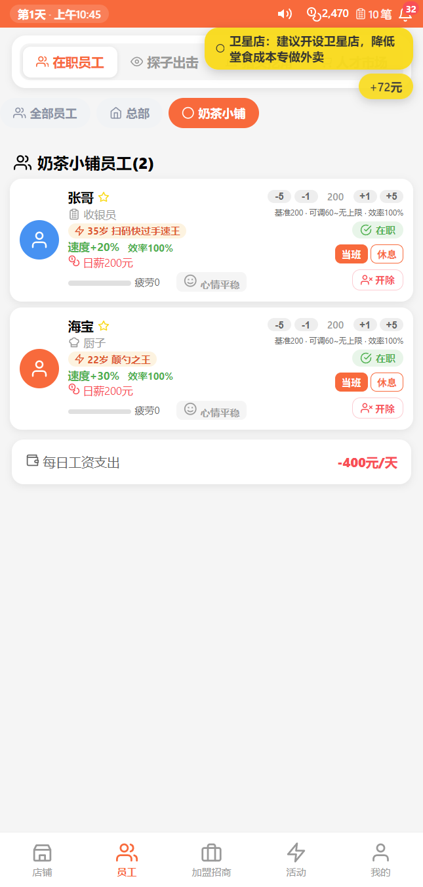 | 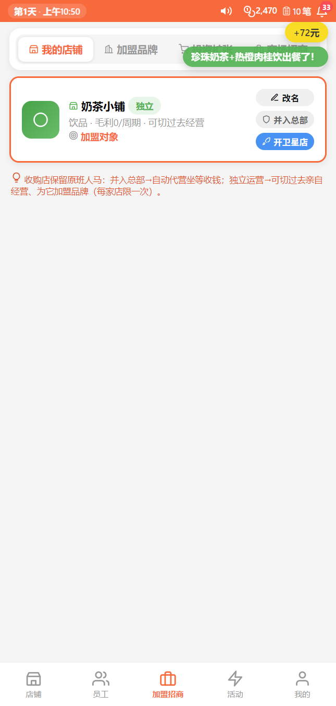 |

| 财务中心 | 活动 | 我的 |
| :---: | :---: | :---: |
| 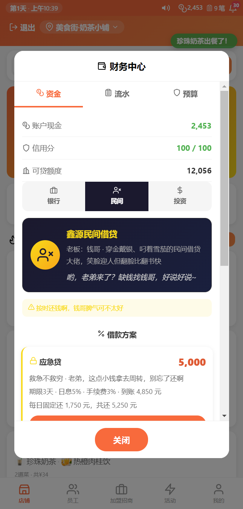 | 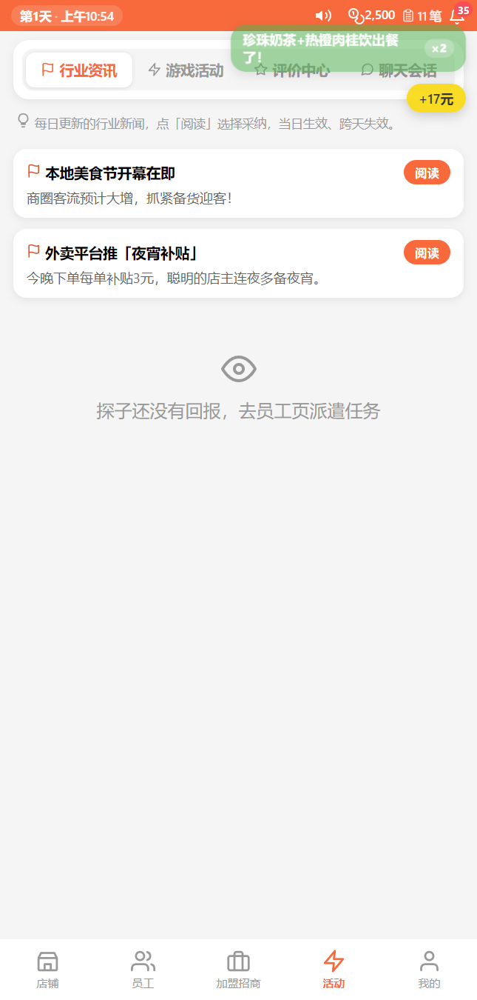 | 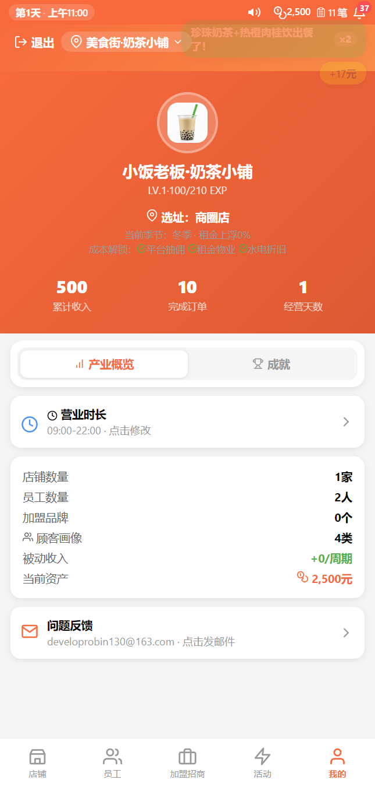 |

| 菜单管理 | 选品策略 | 通知中心 |
| :---: | :---: | :---: |
| 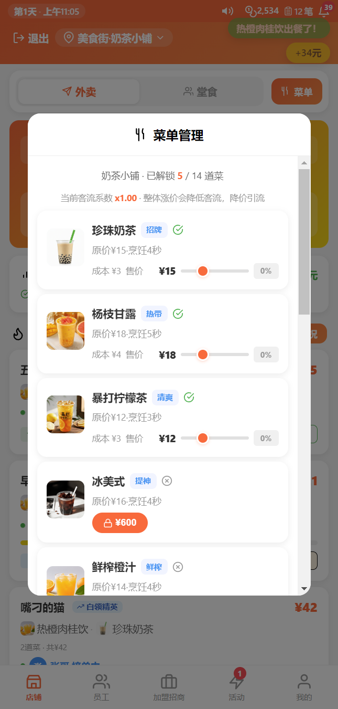 | 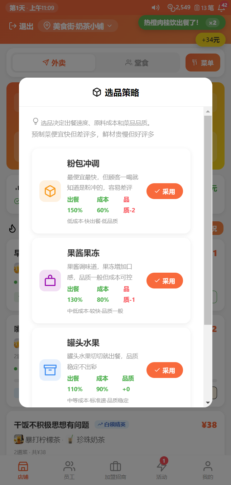 | 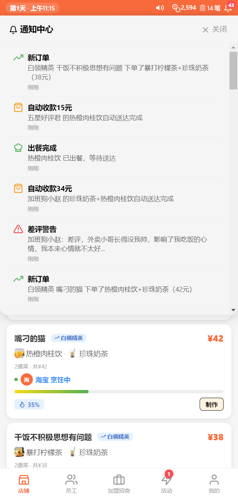 |

> 更多截图（关于、起昵称、店名确认、营业时长、日历、营销活动）见 [`docs/screenshots/`](./docs/screenshots/)。

## 试玩方式

### 在线版（无需安装，点开即玩）

**<https://canzher-ec4pcjpnb9y.qoder.zone>**

### 方式一：浏览器直接打开（推荐）

下载或克隆仓库后，双击 `index.html` 即可开始，无需安装任何环境。

> 双击（`file://`）模式下，游戏读取的是 `js/data-bundle.js` 里内置的数据副本。
> 如果你修改了 `data/*.json` 并希望双击模式也生效，执行一次 `node tools/build-data-bundle.js` 重新生成副本即可。

### 方式二：本地静态服务器（改数据即时生效）

```bash
# 任选其一
python -m http.server 8000
npx serve .
```

访问 <http://localhost:8000> 即可。此模式下游戏直接读取 `data/*.json`，改完刷新页面就生效，适合做内容/Mod 调试。

### 方式三：桌面 App / Android App

- **Windows / Linux 桌面版**（x64 / x86 / ARM64，deb / rpm）：到 [Releases](https://github.com/Robin0638/canzher-3d/releases) 下载安装器或免安装包，构建与签名说明见 [docs/desktop-build.md](docs/desktop-build.md)。
- **Android**：[Releases](https://github.com/Robin0638/canzher-3d/releases) 下载 `CanZher-1.0.0-android.apk`（含 arm64-v8a / armeabi-v7a / x86 三种架构；安装时需允许「未知来源应用」）。自行打包方法见 [docs/build.md](docs/build.md)。

### 存档位置

进度保存在浏览器 `localStorage`，无需注册账号；同一浏览器可玩多账号（通过「加载存档」切换）。

首页的「导出存档 / 导入存档」把全部老板的进度打包成一个 JSON 文件，整个流程不联网：

- **HBuilder 真机运行 / 打包 App**：写入设备公共「文档」目录下的 `餐这儿存档.json`；被分区存储挡住时自动改存应用私有文档目录，提示里给出真实路径。
- **浏览器**：弹出系统「另存为」，可直接选到「文档」文件夹；浏览器不支持时退回下载目录。
- **分享存档**：App 端直接拉起系统分享面板（微信/QQ/蓝牙等，iOS 为隔空投送/存储到文件）；浏览器端走 Web Share API，不支持时退回下载。
- 导入会覆盖本机全部存档，执行前会先让你确认；App 端点「导入存档」可先选方式——**从文档目录读取**（自动找之前导出的文件，含旧版 `餐志儿存档.json`）或**选择文件**（系统文件选择器，可从微信/QQ 收到的文件、下载目录等任意位置导入）。

## 仓库结构

| 路径 | 说明 |
|------|------|
| `index.html` | 入口页面 |
| `js/game.js` | 全部游戏逻辑（内联 Three.js r147，用于店铺 3D 场景） |
| `js/data-bundle.js` | **自动生成**：`data/*.json` 的内置副本，供 `file://` 双击模式兜底 |
| `css/styles.css` | 样式 |
| `data/*.json` | 全部游戏数据（菜品/店铺/评价/事件/升级/配置），可直接编辑 |
| `dishes/` | 菜品图（181 张 PNG，按品类前缀命名） |
| `img/avatars/` | 头像 |
| `icons/` | 图标 SVG 源文件（运行时用 `js/game.js` 内联的图标表，此目录供设计与文档参考） |
| `tools/` | 构建脚本：`node tools/build-data-bundle.js` |
| `docs/` | 截图、打包说明、数据清单 |

## 隐私合规

本项目为纯单机游戏：不联网、不收集个人信息，存档仅保存在设备本地。合规文件如下：

- **各平台隐私政策全文**：[docs/privacy/](./docs/privacy/)（Android / iOS / 网页版三份）
- **应用内离线政策页**：[privacy.html](./privacy.html)（Android 首启弹窗与游戏内「关于 → 隐私政策」的链接目标，离线可读）
- **Android 原生隐私弹窗**：[androidPrivacy.json](./androidPrivacy.json)（HBuilderX 3.2.1+ 方式）+ `manifest.json` → `plus.privacy`（旧方式兜底），两处文案一致
- **政策 ↔ 代码逐条对照表、上架填报指引、维护约定**：[docs/privacy/README.md](./docs/privacy/README.md)

> 修改任何涉及数据存储、系统权限、第三方 SDK 或联网的功能前，请先按 `docs/privacy/README.md` 的维护约定同步更新政策文本。

## 许可证

- **代码**：MIT License → [LICENSE](./LICENSE)
- **素材**（图片、音频、图标）：CC BY 4.0 → [LICENSE-assets](./LICENSE-assets)

代码与素材分开授权，便于二次创作与 Mod 分发。第三方组件（Three.js、Feather Icons）见 [THIRD-PARTY-NOTICES.md](./THIRD-PARTY-NOTICES.md)。

> `img/avatars/` 下的 7 个头像由 AI 生成，文件内已写入国家规定的 AIGC 隐式标识（`ContentProducer` / `ProduceID`）。
> 其余素材（181 张菜品图、UI 图标、截图）均为非 AI 生成。

## 贡献

欢迎 Issue、PR 和 Mod 内容贡献。

- 代码 / Bug / 流程：见 [CONTRIBUTING.md](./CONTRIBUTING.md)
- 内容 Mod（菜品、评价、事件、数值）：见 [docs/MODDING.md](./docs/MODDING.md)

> 问题反馈邮箱：`developrobin130@163.com`（`data/config.json` → `contactEmail`），
> 「关于」页与游戏内「我的」页都会展示反馈入口。更换邮箱后执行
> `node tools/build-data-bundle.js` 同步内置副本即可。
>
> 如需在「关于」页放 B 站 / 抖音 / 仓库跳转，填同一文件里的 `links` 字段（留空即不显示该行）。

> 内容贡献尤其简单：编辑 `data/dishes.json`、`data/shops.json`、`data/seasonal_dishes.json` 即可新增/修改菜品和店铺，无需懂代码。
## 桌面版（Windows / Linux）

本项目除安卓 App 外，也提供 Electron 封装的桌面版：

- **Windows**（x64 / x86 / ARM64）：NSIS 安装器、免安装便携版、zip
- **Linux**（amd64 / arm64 / armhf）：`.deb` + `.rpm`

构建方法见 [docs/desktop-build.md](docs/desktop-build.md)。
